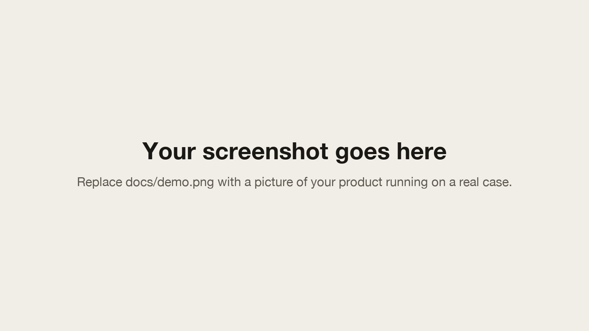

# PitchCheck

<!-- This file is your Product Page. Replace everything in [brackets] with your own words.
     Your page updates about a minute after you commit. Never put an API key here: this page is public. -->

PitchCheck checks the numbers in a bond pitch against the issuer's SEC filings before a student fund's investment committee votes on it.

**Status, November 25:** it reads a deck and pulls the issuer's figures from SEC filings. It does not compare the two yet. The early version is online and needs an access code.

[See it work](#see-it-work) · [Try it](https://arsh-project.onrender.com) · [Code](https://github.com/gen-ai-lab-f26/arsh-project)

## Who it's for

**The person:** Members of the investment committee (IC) of the fixed income fund in NYU Stern's student-managed investment fund (MPSIF). Every member writes bond pitches and reviews the others' before the vote.

**Today:** A member builds a deck from company filings, data terminals and broker quotes and uploads it to the fund's shared drive. Nobody checks the numbers before the IC votes.

**With PitchCheck:** Paste the pitch in. A table comes back with every number, whether it matches the filing, and a link to the filing. The reviewer reads only the flagged rows.

## See it work

[Watch our 90-second demo video](https://example.com) (add the link before December 8)

## How it works

Steps 1 and 3 run today. Steps 2, 4 and 5 are not built yet.

1. A bond pitch goes in as a .pptx or .pdf file.
2. The AI reads the pitch and lists the numbers it claims. It never supplies a financial figure.
3. Code pulls the issuer's reported figures from SEC's structured data and does the arithmetic, such as trailing twelve months. Prices, spreads and ratings are labeled "not in filings", not guessed.
4. The writer confirms the issuer and the pitch date, then accepts each flag or dismisses it with a reason. PitchCheck never edits the pitch.
5. A table of every number with its status and filing link comes out.

## Evidence

Baseline: a plain AI chat with the deck's text pasted in and no tools. The full log is in [TEST_LOG.md](https://github.com/gen-ai-lab-f26/arsh-project/blob/main/TEST_LOG.md).

| Check | Baseline | PitchCheck |
| --- | --- | --- |
| [Check 1] | [Pass or fail] | [Pass or fail] |
| [Check 2] | [Pass or fail] | [Pass or fail] |
| [Check 3] | [Pass or fail] | [Pass or fail] |
| [Check 4] | [Pass or fail] | [Pass or fail] |
| [Check 5, meant to break it] | [Pass or fail] | [Pass or fail] |

### Outside testers

[What two or three people outside your team did when you handed it over without coaching, and where they got stuck.]

### What broke, and what we changed

[One real failure, how you found it, and the fix.]

## What it costs

**Per run:** [$0.00], measured by [how you measured it].

**At 50 users:** [Your estimate for a week of real use.]

## Our call

**[Ready for real users / Needs another round / Stop here]**

[Two or three sentences on why, pointing to your evidence.]

## Build log

### Ideation & build studio · November 24

**Idea.** A fact-checker for the bond pitches my fund's IC votes on. Nobody checks the numbers in a pitch today.

**Repo setup.** Made this repo from the class template, turned on the Product Page, and wrote the product brief in [INTENT.md](https://github.com/gen-ai-lab-f26/arsh-project/blob/main/INTENT.md).

**What I started.** Before writing the claim, I read three real pitches and checked two of them by hand against SEC data:

- Whole slides are prices, spreads and ratings, which filings cannot confirm.
- Most filing figures matched. One trailing-twelve-month revenue figure was 0.6% off, and one EBITDA figure differed because the data vendor defines it differently from the filing.
- Two of the three decks state a number two different ways, such as a position size or a spread.

So the first claim covered two checks: figures against filings, and the deck against itself.

**November 25.** I built the SEC lookup and the deck reader, then ran the baseline on two decks. A plain chat found the numbers stated two different ways, including the position size, but said it could not see filings newer than its training data. So I cut the deck-against-itself check and kept the one a chat cannot do.

**What I learned in class.** [Add.]

### Build studio · December 1

[What changed, and what your outside testers found.]

### Final demo · December 8

[What shipped, and what you would do next.]

## Who did what

Arsh Jain: everything (solo).

Models and tools used: Claude Code as the coding agent, for the repo setup, the pitch sizing and the first draft of the brief. [Add the model the product runs on once it is chosen.]
